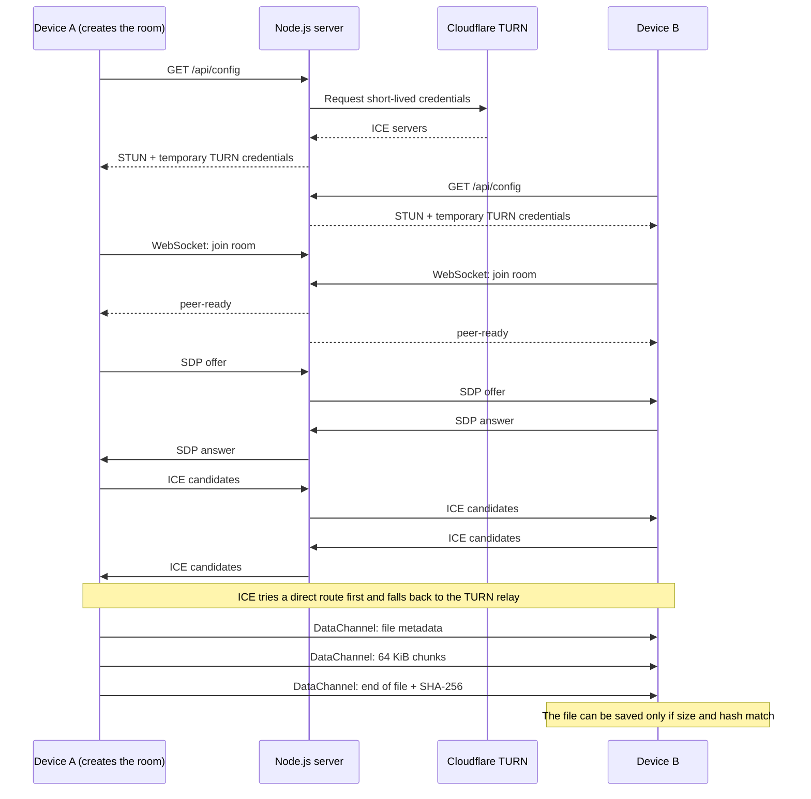

# Ponte

Peer-to-peer file transfer between a computer and a phone, in the browser. No account, and no server storing your files. "Ponte" means "bridge" in Portuguese.

## Why it exists

Moving a file from a computer to a phone usually means sending it to yourself through a chat app or a cloud drive, so the file ends up on someone else's server. Ponte connects the two devices directly. The server only introduces them, and the content travels over an encrypted WebRTC channel.

## Features

- Pairing with a temporary 6-digit code or a QR code
- Multiple files in sequence, with progress, plus text messages
- Encrypted transport (DTLS) and a visual security code to compare on both screens
- Incremental SHA-256 on both sides: a file that is altered or incomplete is discarded
- Installable PWA for Android, iOS, Windows, macOS and Linux
- No database and no file storage on the server

## How it works



## Technical decisions

**Peer-to-peer instead of upload.** The server never receives file contents, so it stays small: no database, no object storage, and nothing to delete afterwards.

**Custom signaling over WebSocket.** The protocol has only what pairing needs: `join`, `signal`, `peer-ready` and `peer-left`. Rooms hold two devices, expire after 15 minutes and live in memory, which is why this version runs as a single instance.

**STUN first, TURN as a fallback.** A direct route costs nothing and works on many networks. Devices on different networks, such as Wi-Fi and 4G, may need the relay.

**TURN secrets stay on the server.** The Cloudflare token exists only in environment variables. Browsers receive short-lived credentials from `/api/config`.

**512 MB per file.** Traffic that goes through the TURN relay has a cost, so the limit keeps that under control. The receiver also holds the file in memory until the hash is verified, which makes very large files impractical in a browser.

**Chunking with backpressure.** Files are read and sent in 64 KiB chunks. The sender pauses when the DataChannel buffer passes 2 MiB and resumes when it drops below 512 KiB, so a fast sender does not exhaust memory.

**Incremental SHA-256.** Web Crypto cannot hash a stream, so the app includes an incremental implementation that checks itself against a known test vector at startup.

**Security code.** Both devices hash the SDP offer and answer and show the first bytes. Since the SDP carries the DTLS fingerprints, different codes mean the connection should not be trusted, even if the signaling server is compromised.

**Abuse limits.** Join attempts and `/api/config` requests are limited per IP. WebSocket messages have rate and size limits, the WebSocket origin is validated, and responses carry a strict Content Security Policy.

## Stack

Node.js 20+, `ws`, WebRTC, vanilla JavaScript PWA, `qrcode`, `qr-scanner`, Docker, Render, Cloudflare Realtime TURN.

## Run locally

```bash
npm install
npm start
```

Open `http://localhost:4173`. To try it on one computer, create a connection in one tab and enter the code in another.

TURN is optional. To enable it, copy `.env.example` to `.env`, fill in the Cloudflare values and start the server with:

```bash
node --env-file=.env server.js
```

Phones need HTTPS to install the PWA and use the camera. See [DEPLOY.md](./DEPLOY.md) for the production setup.

## Tests

```bash
npm run check
npm test
```

`npm test` covers HTTP endpoints, temporary TURN credentials, QR codes, origin validation, the `/api/config` rate limit and the order of signaling messages.

## Limitations

- The 6-digit code helps devices find each other. It is not a strong password, and the security code is what protects against the wrong device pairing.
- iOS and some browsers may suspend a transfer when the app goes to the background.
- The receiver has to tap "Save" to write the verified file to disk.
- Anyone who reaches `/api/config` can get temporary TURN credentials, within the rate limit.

## What I learned

- WebSocket events do not wait for async handlers, so SDP and ICE messages have to go through an explicit queue to stay in order.
- ICE candidates can arrive before the remote description. They need to be held and applied later, otherwise the connection fails between some computers. `test/signaling.js` covers these cases.
- Some browsers do not treat WebSocket URLs as part of `connect-src 'self'`, so the CSP has to name the `wss://` origin explicitly.

## Next steps

- Issue TURN credentials only after two devices are paired in a room
- Write to disk while receiving, using the File System Access API, to go beyond the memory limit
- Move rooms to a shared store such as Redis to allow more than one instance

## License

[MIT](./LICENSE)
